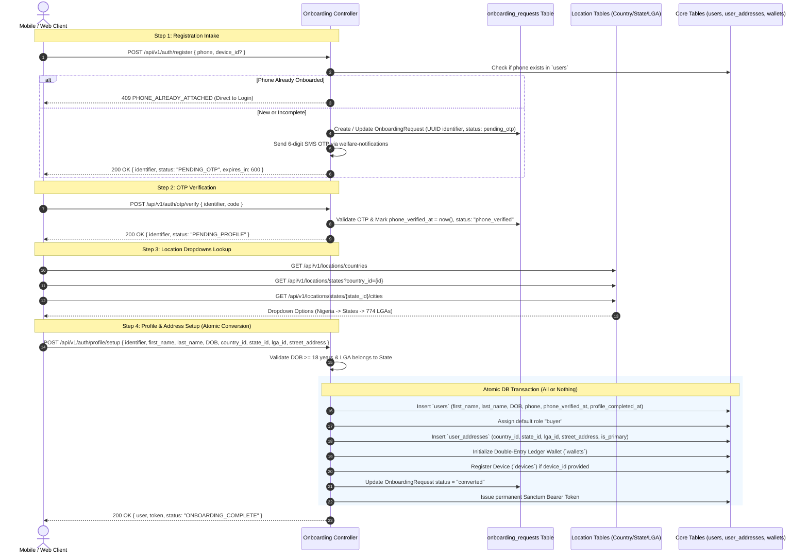

# Onboarding Architecture Plan: Staging Table (`OnboardingRequest`) & Location Hierarchy

## 1. Overview & Architectural Rationale

This plan implements a dedicated **Staging Table (`OnboardingRequest`)** architecture inspired by `welfareMFB` for user registration in LiveBids.

### Why the Staging Table (`onboarding_requests`) Pattern?
1. **Zero Database Pollution**: Users who drop off during phone verification or profile completion will never pollute the core `users` table.
2. **Strict Invariants on `users`**: Every record in `users` is guaranteed to be an adult (≥ 18 years old) with a verified phone, real name, and physical pickup address.
3. **No Ghost Financial Wallets**: Ledger wallets and user IDs are created **only** upon full onboarding completion inside an atomic database transaction.
4. **Clean Garbage Collection**: Abandoned onboarding requests can be pruned safely on a 7-day TTL retention cron without touching the core `users` table or cascade dependencies.

---

## 2. Onboarding Lifecycle Flow



---

## 3. Detailed Proposed Changes

### A. Database Migrations & Models

#### 1. Staging Table: `2026_11_04_000001_create_onboarding_requests_table.php`
- `id` (bigint primary key)
- `identifier` (uuid unique index)
- `phone` (string 30 index)
- `status` (string enum: `pending_otp`, `phone_verified`, `converted`, `expired`)
- `phone_verified_at` (datetime nullable)
- `attempts` (integer default 0)
- `device_id` (string nullable)
- `platform` (string nullable default 'android')
- `fcm_token` (string nullable)
- `ip_address` (string nullable)
- `user_agent` (string nullable)
- `expires_at` (datetime)
- `timestamps`

#### 2. Users Table Updates
Add to `users`:
- `first_name` (string, nullable until converted)
- `last_name` (string, nullable until converted)
- `date_of_birth` (date, nullable)
- `phone_verified_at` (timestamp, nullable)
- `profile_completed_at` (timestamp, nullable)

#### 3. Location Tables: `2026_11_04_000002_create_locations_tables.php`
- `countries`:
  - `id` (bigint), `name`, `iso2`, `iso3`, `phone_code`, `currency`, `active`
- `states`:
  - `id` (bigint), `country_id` (foreign key), `name`, `state_code`
- `lgas`:
  - `id` (bigint), `state_id` (foreign key), `name`
- **Seeder**: `LocationSeeder` importing Nigeria, all 36 states + FCT, and 774 LGAs from `welfareMFB/database/data/nigeria_states_lgas.json`.

#### 4. Physical Address Table: `2026_11_04_000003_create_user_addresses_table.php`
- `id` (bigint primary key)
- `user_id` (foreign key to `users.id` cascade delete)
- `country_id` (foreign key to `countries.id`)
- `state_id` (foreign key to `states.id`)
- `lga_id` (foreign key to `lgas.id`)
- `city` (string nullable)
- `street_address` (string)
- `postal_code` (string nullable)
- `is_primary` (boolean default true)
- `verification_status` (string default 'unverified' - ready for future 3rd party address verification)
- `timestamps`

---

### B. Domain Services & Logic (`app/Domain/Identity/`)

#### 1. Model: `app/Domain/Identity/Models/OnboardingRequest.php`
- Enums: `OnboardingStatus` (`PendingOtp`, `PhoneVerified`, `Converted`, `Expired`)
- Helper methods: `isPhoneVerified()`, `isExpired()`, `isConverted()`.

#### 2. Service: `app/Domain/Identity/Services/OnboardingService.php`
- `initiateRegistration(string $phone, ?string $deviceId, ?string $platform, ?string $fcmToken): array`
  - Validates phone availability against `users` table.
  - Creates or refreshes `OnboardingRequest`.
  - Dispatches SMS OTP via `welfare-notifications`.
  - Returns `['identifier' => $request->identifier, 'status' => 'PENDING_OTP']`.
- `verifyOnboardingOtp(string $identifier, string $code): array`
  - Verifies OTP against `otp_codes` table.
  - Updates `OnboardingRequest` to `phone_verified` and sets `phone_verified_at = now()`.
  - Returns `['identifier' => $request->identifier, 'status' => 'PENDING_PROFILE']`.
- `completeOnboarding(string $identifier, array $profileData): array`
  - Validates `OnboardingRequest` is verified and unexpired.
  - Validates Age ≥ 18 years.
  - Executes atomic conversion in `DB::transaction()`:
    1. Creates `User`
    2. Assigns `buyer` role
    3. Creates primary `UserAddress`
    4. Creates `Wallet`
    5. Creates `Device` if device_id given
    6. Updates `OnboardingRequest->status = 'converted'`
    7. Generates Sanctum personal access token
  - Returns `['user' => $user, 'token' => $token, 'status' => 'ONBOARDING_COMPLETE']`.

#### 3. Service: `app/Domain/Identity/Services/LocationService.php`
- Provides cached access to `getCountries()`, `getStates(?int $countryId)`, `getCitiesOrLgas(int $stateId)`.

---

### C. HTTP Controllers, Routes & Middleware

#### 1. Controller: `app/Http/Controllers/Api/V1/OnboardingController.php`
- `register(RegisterRequest $request)`
- `verifyOtp(VerifyOnboardingOtpRequest $request)`
- `completeProfile(CompleteProfileRequest $request)`

#### 2. Controller: `app/Http/Controllers/Api/V1/LocationController.php`
- `countries()`
- `states(Request $request)`
- `cities(int $stateId)`

#### 3. Route Files:
- `routes/api/v1/onboarding.php`:
  ```php
  Route::prefix('auth')->group(function () {
      Route::post('register', [OnboardingController::class, 'register']);
      Route::post('otp/verify', [OnboardingController::class, 'verifyOtp']);
      Route::post('profile/setup', [OnboardingController::class, 'completeProfile']);
  });
  ```
- `routes/api/v1/locations.php`:
  ```php
  Route::prefix('locations')->group(function () {
      Route::get('countries', [LocationController::class, 'countries']);
      Route::get('states', [LocationController::class, 'states']);
      Route::get('states/{stateId}/cities', [LocationController::class, 'cities']);
  });
  ```
- Both registered in `RouteServiceProvider` at the provider level.

#### 4. FormRequests:
- `RegisterRequest`: validates phone number format.
- `VerifyOnboardingOtpRequest`: validates `identifier` (uuid exists in `onboarding_requests`), `code` (6 digits).
- `CompleteProfileRequest`:
  - `identifier`: `required|uuid|exists:onboarding_requests,identifier`
  - `first_name`: `required|string|min:2|max:50`
  - `last_name`: `required|string|min:2|max:50`
  - `date_of_birth`: `required|date|before_or_equal:-18 years`
  - `country_id`: `required|exists:countries,id`
  - `state_id`: `required|exists:states,id`
  - `lga_id`: `required|exists:lgas,id`
  - `street_address`: `required|string|min:5|max:255`
  - `city`: `nullable|string|max:100`
  - `withValidator()`: Custom validation ensuring `lga_id` belongs to `state_id`.

---

## 4. Verification Plan

### Automated Feature Tests (`tests/Feature/OnboardingTest.php` & `tests/Feature/LocationTest.php`)
1. **Registration & Phone Availability**:
   - New phone -> returns 200 with `identifier` and `PENDING_OTP`.
   - Existing onboarded user phone -> returns 409 `PHONE_ALREADY_ATTACHED`.
   - Repeated register request with unverified phone -> resends OTP and returns existing `identifier`.
2. **OTP Verification**:
   - Invalid OTP -> 422 `OTP_INVALID`.
   - Valid OTP -> updates `onboarding_requests` status to `phone_verified`.
3. **18+ Age Validation**:
   - DOB resulting in < 18 years -> 422 with message `"You must be at least 18 years old to use LiveBids."`
   - DOB resulting in ≥ 18 years -> accepted.
4. **Location Validation**:
   - Fetching countries, states, and LGAs returns seeded Nigerian locations.
   - Submitting an `lga_id` that does not belong to the selected `state_id` -> 422 `"The selected LGA does not belong to the selected State."`
5. **Atomic Conversion**:
   - Successful profile submission creates user, address, ledger wallet, marks request `converted`, and issues valid Sanctum token.
   - Subsequent attempt to reuse same `identifier` -> 409 `ONBOARDING_REQUEST_ALREADY_CONVERTED`.
6. **Full Suite**:
   - Run `php artisan test` to verify all 33 existing tests + new tests pass.
   - Run Laravel Pint formatter.
